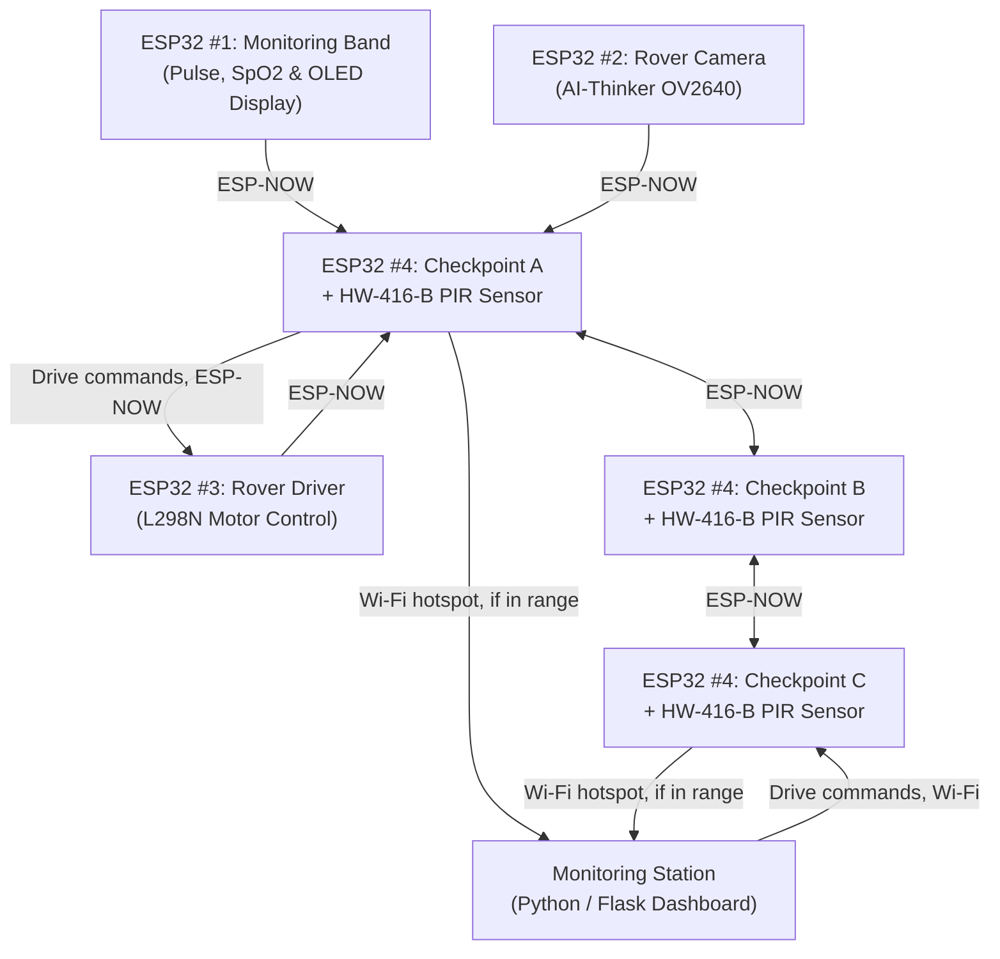

# Field Safety Monitoring System

An end-to-end safety monitoring and incident prevention system designed for hazardous work zones (mines, tunnels, excavation sites, and disaster-prone industrial areas). It continuously monitors worker biometrics, tracks site environmental hazards, allows manual rover inspection via live optical feeds, and renders real-time alerts and live charts on a central station PC dashboard.

---

## 1. System Architecture & 4 ESP32 Roles



| # | ESP32 Role | Directory | Hardware | Responsibility |
|---|---|---|---|---|
| 1 | **Monitoring Band** | `firmware/band/` | MAX30100 / MAX30102 + **0.96" SSD1306 I2C OLED** | Worn by personnel; reads heart rate & SpO2; renders local biometric HUD; transmits to nearest checkpoint over ESP-NOW |
| 2 | **Rover Camera** | `firmware/rover_cam/` | ESP32-CAM (AI-Thinker) | Captures visual frames, chunks data, and transmits optical feed over ESP-NOW |
| 3 | **Rover Driver** | `firmware/rover_driver/` | L298N Motor Driver | Receives manual steering commands; features 2-second safety auto-stop failsafe |
| 4 | **Checkpoint** | `firmware/checkpoint/` | Multi-sensor suite | Reads soldered site sensors; aggregates & relays mesh data to station |

---

## 2. Hardware Pinout & Wiring

### ESP32 #1: Monitoring Band (Wearable)
- **Pulse Oximeter (MAX30100/MAX30102)**: I2C (SDA: **GPIO 21**, SCL: **GPIO 22**)
- **OLED Display (SSD1306 128x64 I2C, 0x3C)**: I2C (SDA: **GPIO 21**, SCL: **GPIO 22**)
- **OLED Screen HUD**:
  - Top Bar: Worker ID & Battery `%`
  - Vitals: Pulse Rate (`BPM`) and Blood Oxygen (`SpO2 %`)
  - Warning Banner: `! HYPOXIA ALERT !` (if SpO2 < 90%) / `! HIGH PULSE !` (if BPM > 120)
  - Footer: Mesh link status (`TX: OK`)

### ESP32 #4: Checkpoint (Soldered Pinout from `PIN_Config.txt`)

| Sensor | Function | ESP32 Pin | Interface / Mode | Notes |
| :--- | :--- | :--- | :--- | :--- |
| **MQ5** | Combustible Gas / Methane / LPG | **GPIO 33** | ADC1_CH5 (Analog) | Critical spike threshold: 600 ADC |
| **MQ7** | Carbon Monoxide (CO) | **GPIO 34** | ADC1_CH6 (Analog) | Critical toxic threshold: 450 ADC |
| **MQ135** | Air Quality / Toxic Vapors | **GPIO 35** | ADC1_CH7 (Analog) | Degraded air threshold: 550 ADC |
| **HW-416-B** | PIR Motion Sensor | **GPIO 26** | Digital Input | **Returns `true` / `false` only** |
| **HW-484-V0.2** | Sound Sensor (AO) | **GPIO 27** | ADC2_CH7 (Analog Peak) | Sound spike / explosion detection |
| **DHT11** | Temperature & Humidity | **GPIO 15** | Digital (Adafruit DHT) | Ambient heat / humidity monitoring |

### ESP32 #3: Rover Driver

| Function | ESP32 Pin | L298N Pin | Description |
| :--- | :--- | :--- | :--- |
| **Left Speed (PWM)** | **GPIO 21** | ENA | PWM Speed Control (0-255) |
| **Left Motor IN1** | **GPIO 18** | IN1 | Forward direction |
| **Left Motor IN2** | **GPIO 19** | IN2 | Reverse direction |
| **Right Motor IN3** | **GPIO 22** | IN3 | Forward direction |
| **Right Motor IN4** | **GPIO 23** | IN4 | Reverse direction |
| **Right Speed (PWM)** | **GPIO 5** | ENB | PWM Speed Control (0-255) |

---

## 3. Running the Central Station Dashboard

Requires **Python 3.9+**.

```bash
# Navigate to dashboard directory
cd dashboard

# Install dependencies
pip install -r requirements.txt

# Start the Flask dashboard server
python app.py
```

Open your web browser at:
👉 `http://localhost:3000`

---

## 4. Testing with the Sensor Mesh Simulator (No Hardware Needed)

In a separate terminal window:

```bash
cd dashboard
python simulator.py
```

---

## 5. Flashing the ESP32 Firmware

All sketches are located in `firmware/`:

1. **Board Package**: Install `esp32 by Espressif Systems` in the Arduino IDE Board Manager.
2. **Required Arduino Libraries**:
   - `Adafruit SSD1306` + `Adafruit GFX Library` (for Band OLED display)
   - `DHT sensor library` (Adafruit) + `Adafruit Unified Sensor`
   - `MAX30100lib` (OXullo Intersecans) for `band.ino`
3. **Flash Settings**:
   - For `checkpoint.ino`, `band.ino`, `rover_driver.ino`: Select **ESP32 Dev Module**.
   - For `rover_cam.ino`: Select **AI Thinker ESP32-CAM**, set Partition Scheme to **Huge APP (3MB No OTA)**, and enable **PSRAM**.
