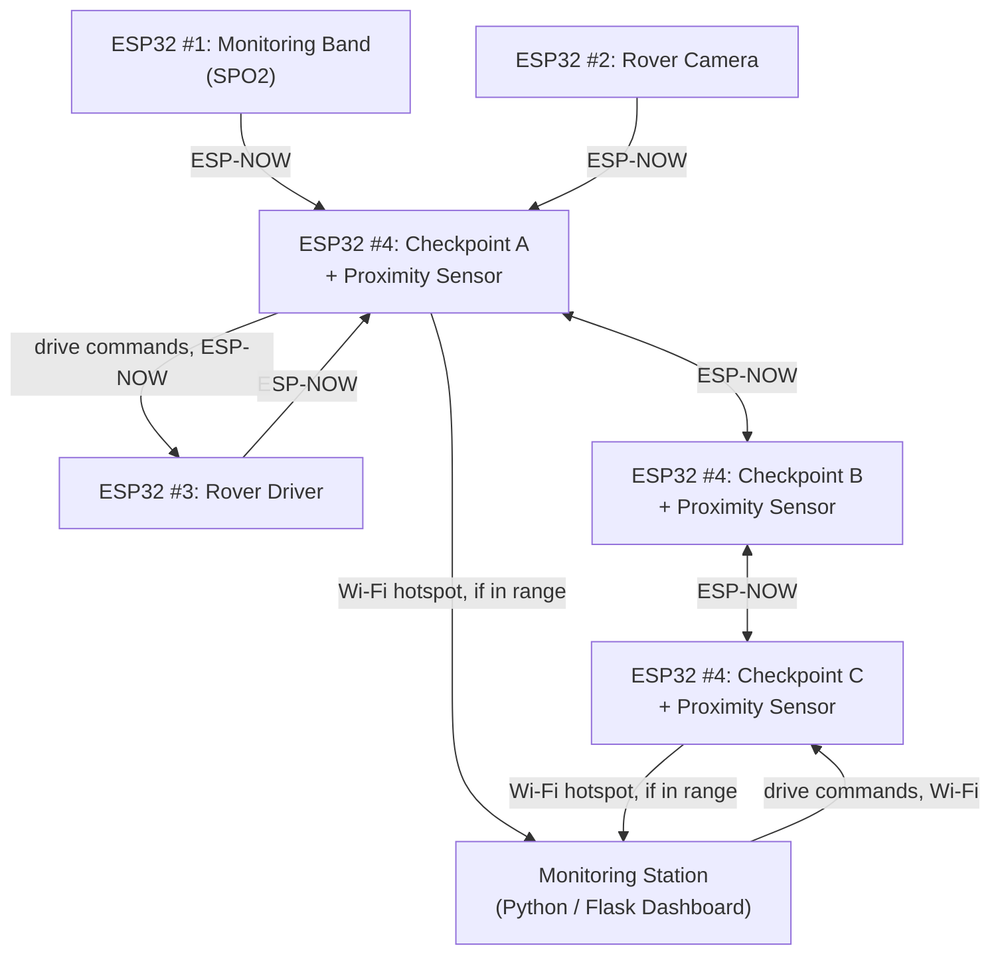
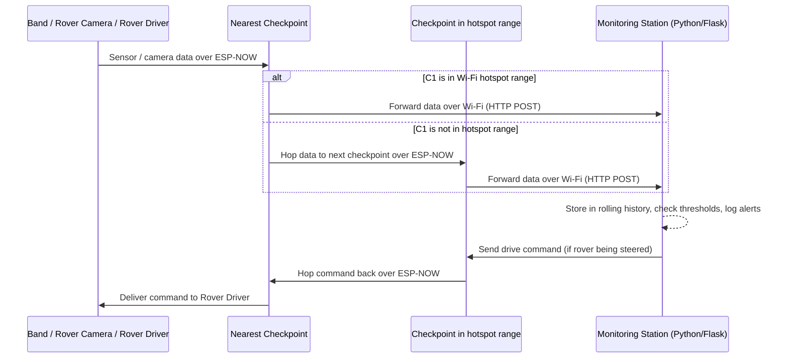

# Product Requirements Document (PRD)

## Field Safety Monitoring System

---

## 1. Overview

A safety monitoring system for personnel working in a hazardous zone (mine, tunnel, disaster-prone site, etc.). It tracks the health of workers, watches environmental conditions across the site, and allows a manually driven rover to visually inspect specific spots — all reporting back to a Python-based dashboard running on a normal PC.

## 2. Problem Statement

In hazardous work zones, dangerous conditions (gas buildup, explosions, landslides, an unexpected object or person approaching a restricted spot) and worker health emergencies (low oxygen, abnormal pulse) can go unnoticed until it's too late. There's no continuous, automated way to watch both the people and the environment at the same time and flag problems immediately.

## 3. Goals

- Continuously track each worker's pulse and oxygen level.
- Continuously monitor environmental conditions (gas levels, temperature, humidity, motion, sudden loud sounds, and objects approaching too closely) at fixed points across the site.
- Allow a person to manually drive a rover to visually inspect any location.
- Get all this data to a central dashboard reliably, even without full Wi-Fi coverage across the site.
- Flag anomalies automatically so nothing depends on someone staring at raw numbers.
- Visualize gas levels, noise levels, and other readings as live charts, not just raw numbers, so trends are easy to catch.

## 4. Non-Goals (Out of Scope for this version)

- Autonomous/self-driving rover behavior.
- Long-range cellular or satellite connectivity.
- Mobile app version of the dashboard (desktop browser only, for now).
- Predictive analytics or AI-based forecasting of hazards.
- Persistent long-term data storage/logging (current version keeps live data in memory only).

---

## 5. Hardware Breakdown — 4 ESP32 Roles

| # | ESP32 Role | Carries | Responsibility |
|---|---|---|---|
| 1 | **Monitoring Band** | SPO2 sensor | Worn by a person; reads pulse and oxygen level; sends readings to the nearest checkpoint |
| 2 | **Checkpoint** | MQ4, MQ7, MQ135, PIR, DHT11, KY038, HC-SR04 (proximity) | Fixed at a location; reads all environment data including how close anything is to the checkpoint; relays its own data plus incoming band/rover data toward the station |
| 3 | **Rover Driver** | Left/right drive motors | Receives manual drive commands (forward/left/right/stop) and moves the rover accordingly |
| 4 | **Rover Camera** | Camera module | Captures and sends visuals so the driver (person) can see where the rover is going, and so the station can view the site |

Note: the Rover Driver and Rover Camera are two separate ESP32 boards, both mounted on the same physical rover.

### Checkpoint sensor detail

| Sensor | Reads | Why it matters |
|---|---|---|
| MQ4 | Methane / natural gas | Flags a gas leak risk |
| MQ7 | Carbon monoxide | Flags a toxic-air risk |
| MQ135 | General air quality | Flags polluted/unsafe air |
| PIR | Motion | Confirms whether anyone is present at that spot |
| DHT11 | Temperature & humidity | Flags an unsafe or extreme environment |
| KY038 | Sudden loud sound | Flags a possible explosion or landslide |
| HC-SR04 | Distance to nearest object | Flags something (person, vehicle, debris) getting unexpectedly close to the checkpoint |

---

## 6. System Architecture

## 7. Data Flow — Step by Step

---

## 8. Functional Requirements

**Monitoring Band (ESP32 #1)**
- FR1.1: Read pulse rate and oxygen level from the SPO2 sensor at a regular interval.
- FR1.2: Send each reading to the nearest checkpoint over ESP-NOW.
- FR1.3: Include a way to identify which person/band the reading belongs to.

**Checkpoint (ESP32 #4, one per physical location)**
- FR2.1: Read all seven sensors (MQ4, MQ7, MQ135, PIR, DHT11, KY038, HC-SR04) at a regular interval.
- FR2.2: Tag all outgoing data with the checkpoint's identity and location.
- FR2.3: Receive data from bands, rover, and neighboring checkpoints over ESP-NOW.
- FR2.4: If a Wi-Fi hotspot is in range, forward all collected data (own + relayed) to the station.
- FR2.5: If no hotspot is in range, forward all data to a neighboring checkpoint instead.
- FR2.6: Relay drive commands coming back from the station to the rover.
- FR2.7: Flag when the proximity sensor detects an object closer than the configured safe distance.

**Rover Driver (ESP32 #3)**
- FR3.1: Receive drive commands (forward, left, right, stop) from the nearest checkpoint.
- FR3.2: Move the rover accordingly using the left/right drive mechanism.
- FR3.3: Send back basic status (e.g. connected/moving/stopped) to the nearest checkpoint.
- FR3.4: Automatically stop if no command has been received recently (safety timeout).

**Rover Camera (ESP32 #2)**
- FR4.1: Continuously capture visuals from the camera.
- FR4.2: Send the visual feed to the nearest checkpoint over ESP-NOW for onward delivery.

**Monitoring Station (Python / Flask dashboard, runs on the PC)**
- FR5.1: Display live data from all bands, all checkpoints, and the rover on one dashboard page.
- FR5.2: Continuously check incoming data against defined safe ranges.
- FR5.3: Visually highlight any reading that falls outside a safe range, and log it to an alerts feed.
- FR5.4: Allow a person to send drive commands to the rover from the dashboard.
- FR5.5: Show which checkpoint each piece of data is currently routing through.
- FR5.6: Render live matplotlib charts for: gas levels (MQ4/MQ7/MQ135), noise level, proximity, temperature/humidity, and band vitals (pulse/SpO2) — each showing one line per device plus a safe-range threshold line.
- FR5.7: Display the latest rover camera frame, refreshed periodically.

---

## 9. Non-Functional Requirements

- **Reliability**: If one checkpoint goes offline, data should still be able to reach the station by hopping through another checkpoint, as long as an alternate path exists.
- **Latency**: Sensor and camera data should reach the dashboard with minimal delay — critical for both health alerts and rover driving.
- **Power**: Band and checkpoints should run for a full working shift/day on their power source before needing a recharge or battery swap.
- **Range**: ESP-NOW range between two neighboring devices should comfortably cover the intended spacing between checkpoints on site.
- **Usability**: Dashboard should be understandable at a glance — anomalies should be visually obvious, and charts should make trends easy to spot without reading raw numbers.

---

## 10. Success Metrics

- Health/environment anomalies are visible on the dashboard within a few seconds of occurring.
- No data loss when a checkpoint is out of direct Wi-Fi hotspot range (data still arrives via hopping).
- Rover can be driven and viewed live without noticeable lag under normal conditions.
- Zero missed critical alerts (e.g. oxygen drop, gas threshold breach, explosion-level sound spike, unsafe proximity) during testing.
- Gas, noise, proximity, environment, and vitals charts stay readable and up to date as more checkpoints and bands are added.

---

## 11. Assumptions

- Checkpoints are spaced closely enough that ESP-NOW hopping between them is always possible.
- At least one checkpoint is within Wi-Fi hotspot range at any given time.
- One person is available to manually drive the rover when needed.
- A single PC running the Flask dashboard is sufficient for the number of people expected to monitor it at once.

## 12. Risks

- If too many checkpoints are offline in sequence, data (and rover control) could be cut off entirely.
- Manual driving depends on live camera feed — any camera lag or dropout affects safe rover operation.
- Gas sensors (MQ series) and the proximity sensor (HC-SR04) typically need a warm-up/calibration period — accuracy could be affected if this isn't accounted for.
- Since the dashboard currently keeps everything in memory, a server restart loses recent history and chart data.

## 13. Open Questions

- Exact safe/danger threshold values for each sensor, including the proximity distance.
- Number of checkpoints and spacing needed for full coverage.
- Power source and expected runtime for band, checkpoints, and rover.
- How rover drive commands should behave if the connection chain briefly drops mid-drive (currently: auto-stop after 2 seconds — confirm this is the desired behavior).
- Whether historical data logging (beyond the current in-memory rolling window) is needed for later analysis or compliance.
